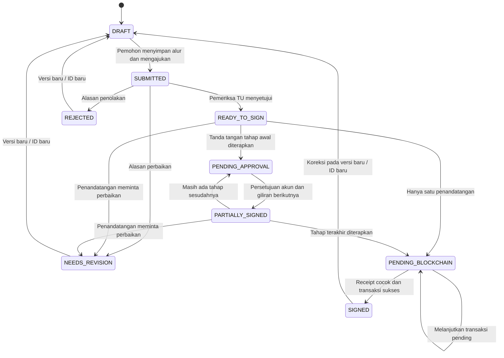

# Revisi aplikasi SIGCHAIN-UAD setelah semhas

Dokumen implementasi, 12 Oktober 2026. Ini menjelaskan perilaku kode hasil revisi; tidak menyatakan SOP fakultas atau penerimaan stakeholder sudah disahkan.

Pemeriksaan lanjutan 13 Oktober 2026 melengkapi unduhan permohonan awal, validasi isi PDF/PNG/JPEG sebelum penyimpanan, penolakan format gambar yang tidak didukung, penanganan ID tidak valid, perlindungan penghapusan semua dokumen yang sudah diproses/berversi, dan batas ukuran PDF gabungan. UI membedakan persetujuan tahap awal dari pencatatan final, nama unduhan mengikuti status, dan hasil tidak terdaftar/pending/gangguan jaringan menggunakan pesan yang sesuai. Halaman dimuat bertahap; build frontend akhir tidak lagi menghasilkan peringatan bundle besar atau impor ganda.

Hasil akhir: build frontend dan backend lulus; 24 pemeriksaan integrasi dengan RPC Hardhat lokal, 9 tes smart contract, dan 10 skenario smoke API lulus. Tidak ada transaksi Sepolia publik atau email eksternal dalam pengujian. File penelitian dan hasil lokal pada `output/` serta `tmp/` tidak termasuk sumber yang didorong ke GitHub.

## Pekerjaan aplikasi A01–A10

- **A01, akun personal dan kapasitas:** Admin membuat akun dengan role, unit, NIM untuk mahasiswa, dan beberapa jabatan pada satu orang. Pemohon memilih ID orang serta kapasitasnya pada setiap tahap. Kapasitas jabatan khusus berasal dari data Admin; kapasitas akademik dasar tersedia bagi dosen. Akun Dekan dapat sekaligus mempunyai jabatan Kaprodi dan menjadi pembimbing pada dokumen berbeda.
- **A02, Mahasiswa:** role `mahasiswa` bisa mengunggah permohonan/dokumen, mengatur alur, mengajukan, membaca status, memperoleh notifikasi, membuat versi perbaikan, dan mengunduh hasil miliknya. Daftar, statistik dashboard, detail, PDF, dan QR diperiksa pada API. Mahasiswa lain tidak dapat melihat dokumen tersebut melalui URL langsung.
- **A03, beberapa tanda tangan:** `signingSteps` menyimpan orang, kapasitas, urutan, posisi, hash tahap, dan waktu. Hanya orang yang mendapat giliran dapat menerapkan/menyetujui tanda tangan. Persetujuan awal menghasilkan status parsial dan mengaktifkan orang berikutnya; blockchain menerima hash PDF setelah tahap terakhir. Satu orang boleh muncul dengan kapasitas berbeda; kombinasi orang/kapasitas yang sama tidak diulang.
- **A04, pemeriksaan dan penolakan:** pemohon memilih pemeriksa TU. Pemeriksa dapat menyetujui, meminta perbaikan, atau menolak dengan alasan wajib. Penandatangan juga dapat meminta perbaikan/menolak sebelum menerapkan tanda tangan. TU dapat mengunggah surat keluaran; PDF permohonan awal tetap disimpan sebagai berkas terpisah.
- **A05, keutuhan dan versi:** tanda tangan tahap berikutnya ditambahkan pada PDF hasil tahap sebelumnya. Area yang bertumpuk dengan tanda tangan yang disetujui ditolak. PDF final tidak ditimpa; koreksi menghasilkan ID/versi baru dengan tautan dua arah. Lease dan versi workflow menangani klik ganda/perubahan bersamaan. Nomor transaksi pending disimpan agar konfirmasi dapat dilanjutkan.
- **A06, PNG transparan:** unggahan PNG yang sudah didukung tetap mempertahankan transparansinya ketika dibubuhkan pada PDF. Panduan Profil menganjurkan PNG transparan. Editor menampilkan preview dan pemeriksaan batas halaman. Editor mendukung pointer/sentuhan dan menyesuaikan skala awal dengan lebar layar.
- **A07, notifikasi dan distribusi:** pemberitahuan dalam aplikasi dibuat untuk pemeriksa, penandatangan berikutnya, pemohon, dan dokumen selesai. Email otomatis tersedia bila SMTP dikonfigurasi. Email berisi pemberitahuan/tautan login, tanpa lampiran PDF. PDF diunduh dari sistem dengan kontrol akses. Jika SMTP gagal, notifikasi aplikasi tetap ada.
- **A08, blockchain server:** transaksi dikirim dari wallet backend ke Sepolia; pengguna tidak memasang MetaMask. Pemberi persetujuan adalah akun yang login, sedangkan wallet server adalah pencatat. Persetujuan tahap awal merupakan catatan akun; bukti pesan wallet server pada final mengikat daftar persetujuan dan hash final. Lihat `SERVER-SEPOLIA.md`.
- **A09, alasan verifikasi:** hasil membedakan MATCH, DIFFERENT terhadap referensi, NOT_REGISTERED, PENDING dan NETWORK_ERROR. ID referensi dari QR dapat digunakan ketika mengunggah file, sehingga hash referensi dan hash unggahan ditampilkan. Hash saja tidak menunjukkan kalimat/halaman yang berubah; aplikasi tidak mengklaim perbandingan visual otomatis.
- **A10, QR dan audit:** QR mengarah ke portal aplikasi, dan tautan Etherscan ada pada bukti transaksi nyata. Halaman QR tambahan ditanam pada PDF sebelum hash final dihitung. QR memeriksa status referensi; unggah PDF untuk memeriksa byte file yang diterima. Audit mencatat aktor, aksi, dokumen/versi/tahap, waktu dan alasan. Audit aplikasi berada di MongoDB, bukan seluruhnya on-chain.

## Cara menggunakan alur baru

1. Admin mengisi nama, role, unit dan jabatan pejabat. Akun mahasiswa dikelola melalui Manajemen User; akun demo mahasiswa adalah `mahasiswa@uad.ac.id` hanya pada seed/demo.
2. Mahasiswa mengunggah PDF. Pada detail, isi jenis dokumen, pemeriksa TU, dan daftar orang/kapasitas; naik/turunkan urutan. Klik **Simpan Alur**, lalu **Ajukan ke TU**.
3. TU membuka notifikasi/dokumen, memeriksa berkas dan bila diperlukan mengunggah surat keluaran. Klik **Setujui Pemeriksaan TU**, atau isi alasan perbaikan/penolakan.
4. Penandatangan aktif membuka editor, melihat dokumen, mengatur posisi, lalu klik **Tandatangani dan Sahkan**. Tahap awal diteruskan ke orang berikutnya. Orang lain tidak dapat mengambil giliran.
5. Tahap terakhir menghasilkan PDF final dengan QR dan mencatat hash lewat backend. Status `SIGNED` baru diberikan setelah receipt benar-benar berhasil dan cocok dengan dokumen.
6. Mahasiswa mendapat notifikasi selesai dan mengunduh PDF final. Gunakan QR untuk status referensi, lalu unggah PDF jika ingin memeriksa salinan yang diterima.
7. Jika perlu perbaikan/koreksi final, unggah PDF pada **Buat Versi Baru**. Versi sebelumnya tetap tersimpan dan tidak ikut berubah; versi baru perlu diajukan serta disetujui kembali.

## Alur status

Panah versi baru berarti dokumen penerus baru; status dan hash dokumen final lama tetap disimpan. Dokumen lama memiliki `supersededBy` dan tidak diproses ulang.

## Batas operasional yang perlu diisi pengguna

- Isi `BLOCKCHAIN_PRIVATE_KEY` di backend dan danai wallet khusus Sepolia. RPC/alamat kontrak sudah ada pada konfigurasi lokal yang diperiksa, tetapi key server belum diisi. Tes teknis memakai blockchain lokal terisolasi; belum ada transaksi publik yang dibuat oleh agen.
- Untuk email, isi `SMTP_HOST`, `SMTP_PORT`, `SMTP_SECURE`, `SMTP_USER`, `SMTP_PASSWORD`, `SMTP_FROM` dan URL frontend. Kosongkan SMTP untuk memakai notifikasi aplikasi saja. SMTP menggunakan Nodemailer; sesuaikan port/TLS dengan penyedia email. [Dokumentasi resmi SMTP](https://nodemailer.com/smtp).
- Data jabatan dan urutan yang dipilih harus dicocokkan dengan TU. Daftar contoh kapasitas bukan penetapan pejabat resmi.
- Jalur lama penandatanganan tunggal tetap tersedia bagi dokumen/akun internal lama. Pengajuan Mahasiswa harus melewati workflow dan TU; jalur lama tidak memberi akses mahasiswa untuk mengesahkan.
- Antrean nonce wallet berada dalam satu proses backend lokal. Jika menggunakan beberapa worker, sediakan antrean bersama sebelum memperluas concurrency.

## Dokumentasi dan bukti untuk laporan

`docs/PERANCANGAN-REVISI.md` menjelaskan aktor, kebutuhan, use case, activity, data, UI dan arsitektur. `docs/VALIDASI-TU-DAN-PENGUJIAN.md` memuat bahan validasi stakeholder dan evaluasi pengguna. `output/semhas/Draf-Revisi-Laporan.md` membantu menata Bab I–V tanpa membuat hasil wawancara/SUS baru.

Pengujian API terisolasi tersedia melalui `npm run test:server-signing` di backend. Tes mencakup empat kombinasi login, pemisahan identitas, akses mahasiswa, urutan tiga orang, pemeriksaan TU, versi, notifikasi, alasan verifikasi, receipt salah, key kosong, retry, dan transaksi bersamaan. Skenario dan hasil eksekusi terakhir dicatat dalam `testing/README.md`; hasil otomatis bukan pengujian penerimaan oleh dosen/TU.
