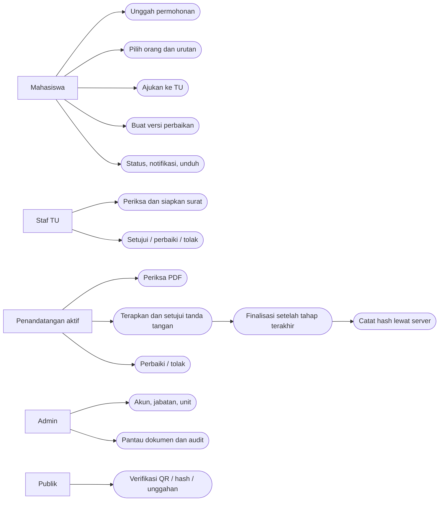
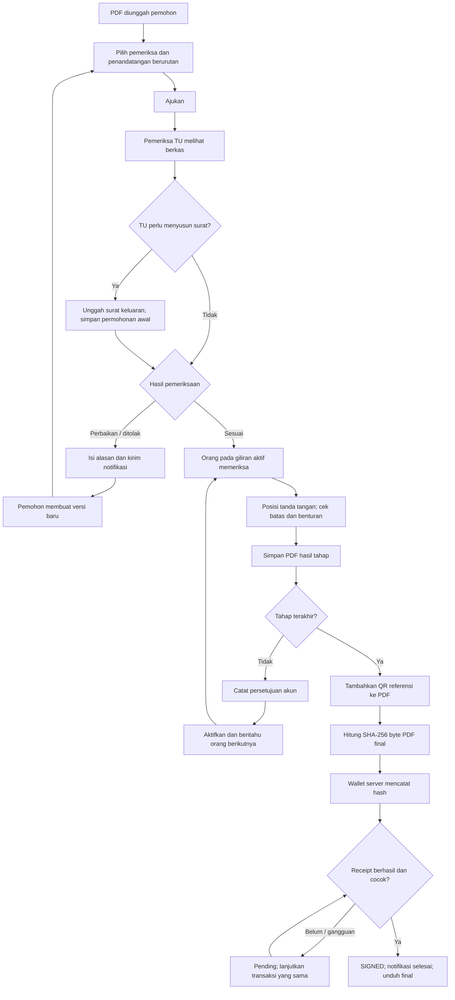
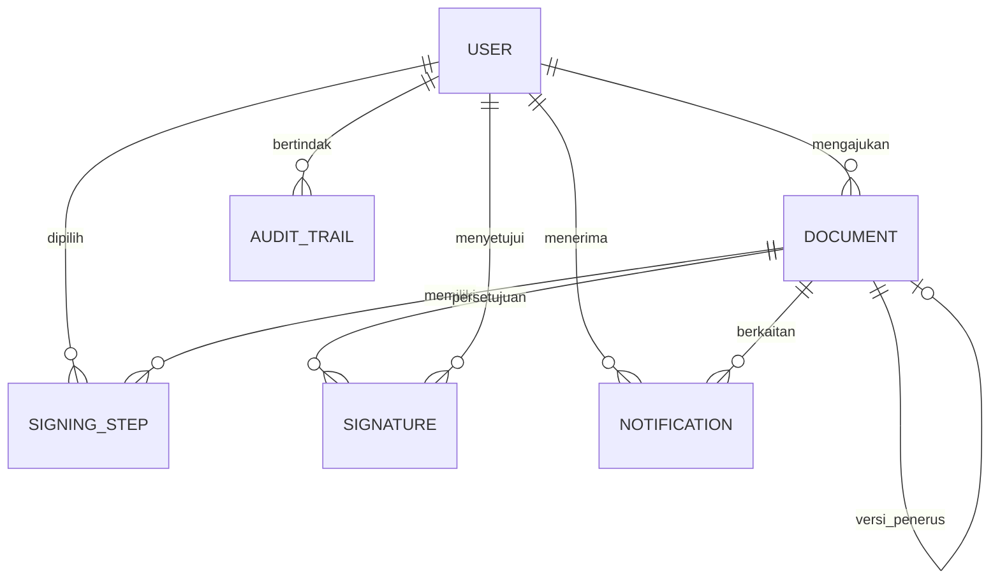
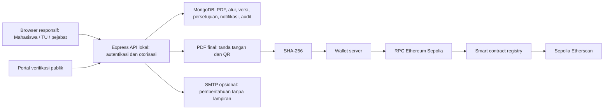

# Perancangan aplikasi hasil revisi semhas

Ini dokumentasi implementasi untuk dipakai menyusun bagian perancangan Bab IV. Alur usulan masih perlu validasi TU; jangan menyebutnya SOP resmi sebelum disepakati.

## Aktor dan kebutuhan pengguna

Mahasiswa mengajukan dan memperoleh dokumen miliknya. Staf TU memeriksa permohonan dan dapat menyiapkan surat keluaran. Pejabat penandatangan adalah orang dengan kapasitas tertentu pada dokumen, tidak sekadar nama role. Admin mengelola akun/jabatan dan pemantauan. Pemeriksa publik memeriksa bukti referensi atau hash unggahan tanpa login.

Hak akses sistem (`mahasiswa`, `staff_administrasi`, `staff_akademik`, `admin`) dibedakan dari jabatan institusi dan kapasitas pada tahap. Role dalam database menggunakan nama teknis untuk kompatibilitas; label antarmuka menjelaskan fungsinya.

## Kebutuhan dan use case

- FR01 autentikasi dan profil: login/logout, pembaruan nama, empat kombinasi kredensial.
- FR02 akun dan jabatan: Admin membuat/mengubah akun personal, role, unit, jabatan, NIM; aktor Admin.
- FR03 pengajuan: unggah PDF individual/massal dan baca detail milik pemohon; aktor Mahasiswa/TU.
- FR04 konfigurasi alur: pilih pemeriksa dan urutan orang/kapasitas; aktor Pemohon/Admin sebelum submit.
- FR05 submit: kirim pengajuan ke pemeriksa personal; aktor Pemohon/Admin.
- FR06 pemeriksaan: preview, siapkan surat keluaran opsional, setujui/perbaiki/tolak; aktor Pemeriksa TU.
- FR07 persetujuan tahap: periksa dokumen, pilih posisi, terapkan PNG dan setujui giliran sendiri; aktor Penandatangan aktif.
- FR08 penolakan penandatangan: alasan perbaikan/penolakan sebelum penandatanganan; aktor Penandatangan aktif.
- FR09 finalisasi/pencatatan: QR selesai sebelum hash final, transaksi backend, pemeriksaan receipt dan retry; aktor Sistem atas persetujuan tahap terakhir.
- FR10 distribusi: notifikasi aplikasi/email opsional, unduh berkas sesuai akses; aktor Pemohon/Peserta.
- FR11 versi: perbaikan membuat dokumen penerus dan menghubungkan versi; aktor Pemohon/Admin.
- FR12 verifikasi: hash/file/QR, perbandingan referensi, status gangguan jaringan; aktor Publik/Pengguna.
- FR13 audit: actor/action/document/version/stage/time/reason; aktor Pengguna/Admin sesuai cakupan.
- FR14 dashboard/notifikasi: ringkasan dokumen dalam cakupan akun dan notifikasi milik akun; aktor Pengguna.

Login menjadi prasyarat use case internal. Pencatatan blockchain adalah aktivitas sistem dalam pengesahan final, bukan permintaan pengguna memasukkan hash/wallet secara manual.

## Activity pengajuan, pemeriksaan, dan penandatanganan

Activity subproses penolakan/versi mengikuti alasan → notifikasi → PDF baru dengan ID baru → pemeriksaan ulang. Activity verifikasi mengikuti referensi → hash unggahan opsional → pembacaan catatan → status/reason dan kedua hash. Activity akun mengikuti Admin → validasi data → simpan → audit. Pemetaan FR di atas membantu menurunkan activity per use case yang disepakati pembimbing, tanpa membuat diagram duplikat per role.

## Data dan storage

- User: identitas personal, role, jabatan, unit, NIM opsional, password hash; field wallet lama dipertahankan untuk kompatibilitas.
- Document: pemohon, pemeriksa, daftar signingSteps, currentStep, status, workflowVersion, version, previousVersionId/supersededBy, alasan; binary request/draft/signed dipisahkan dan tidak diserialisasikan dalam JSON.
- SigningStep: ID orang, kapasitas, status, posisi PDF, hash tahap, waktu penerapan/persetujuan.
- Signature: akun pemberi persetujuan, indeks tahap, kapasitas, metode account_approval/server_wallet, waktu dan bukti final.
- Notification: akun penerima, dokumen, pesan, waktu baca, status email; pembacaan dibatasi akun pemilik.
- AuditTrail: aktor, aksi, waktu, IP, metadata dokumen/versi/tahap/alasan.
- Smart contract: hash final, wallet pencatat, nomor blok dan timestamp. Byte PDF serta seluruh log administrasi tetap off-chain.

SigningStep secara implementasi ditanam dalam koleksi Document. Diagram relasi menjelaskan hubungan konseptual, bukan mengklaim koleksi SQL terpisah.

## Arsitektur dan antarmuka

Layar utama: login empat role; dashboard dalam cakupan akun; upload; detail dengan panel workflow, pemeriksa, orang/kapasitas/urutan, alasan dan versi; editor PDF dengan skala/pointer; notifikasi; manajemen akun/jabatan; verifikasi dengan referensi dan dua hash; audit. Blockchain/hash/transaksi ditempatkan pada tab detail, sedangkan aksi utama berbahasa pengesahan dokumen.

NFR: kontrol akses diuji melalui API/URL langsung; byte PDF final diverifikasi ulang; mutasi workflow dilindungi optimistic version/lease; PNG transparan didukung; editor dan form memakai layout responsif; SMTP dan wallet key tetap di server. Bukti HTTPS, ketersediaan layanan, latensi lingkungan produksi, dan uji kegunaan manusia harus diambil dari deployment/pengujian sebenarnya, bukan disimpulkan dari typecheck.
